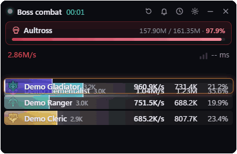
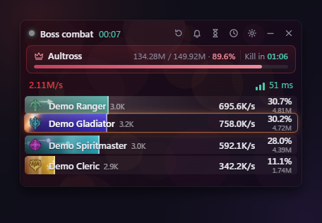
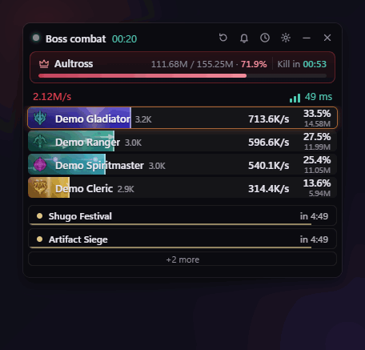
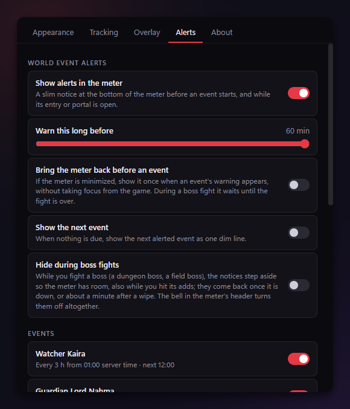

# Scarlet Meter

**A DPS meter for AION 2 (Global) that shows who is doing what, live, in a clean overlay over the game.**
Unzip it, run it, and it finds the game by itself: no installer, no .NET to install, and no administrator rights
once Npcap is set up.
It is built on [RATmeter](https://github.com/Kuroukihime/AIon2-Dps-Meter)'s proven packet decoding, with its own
overlay and extras: a boss card with a "Kill in" estimate, animated bar effects for every class, world-event
alerts, and a background picture of your choice.

<p align="center"></p>
<p align="center"><sub>Demo mode, made-up players: <code>.\ScarletMeter.exe --demo</code></sub></p>

> **Early release.** Its in-game checks are not finished, so numbers may be off. Reports are welcome in
> [Issues](https://github.com/harrynguon/Scarlet-Meter/issues).

## Download and run

You need Windows 11, 64-bit (Windows 10 has not been tried; it may need the
[WebView2 Runtime](https://developer.microsoft.com/microsoft-edge/webview2/) first).

1. **Install [Npcap](https://npcap.com/#download)** (the packet-capture driver every network-based meter uses).
   In its installer, tick **"Install Npcap in WinPcap API-compatible Mode"**, and leave **"Restrict Npcap
   driver's access to Administrators only"** unticked, so the meter never needs administrator rights. (Npcap's own
   installer asks for an administrator once, as any driver does.)
2. **Download** the latest `ScarletMeter-<version>-win-x64.zip` from
   [Releases](https://github.com/harrynguon/Scarlet-Meter/releases) and **unzip** it anywhere you can write to:
   Documents, Desktop, a games folder (not Program Files).
3. **Start the game, then double-click `ScarletMeter\ScarletMeter.exe`.** It shows "Waiting for the game's
   connection..." until it finds the game, then tracks every fight on its own.

That is all. **Ctrl+Shift+D** hides and shows the meter (changeable). Windows may warn that the file comes from an
unknown publisher, because it is not code-signed: choose "More info", then "Run anyway". Each release comes with
SHA-256 checksums and its complete source, and is built by GitHub Actions from the tagged source, not on anyone's PC.

- **Try it without the game:** in the `ScarletMeter` folder, Shift+right-click an empty space, choose "Open in
  Terminal" and run `.\ScarletMeter.exe --demo` for made-up boss fights.
- **Update:** close the meter and extract the newer zip into the folder that *holds* your `ScarletMeter` folder
  (Documents, if the meter is at `Documents\ScarletMeter`), replacing files; in Explorer's "Extract all", change
  the suggested destination to that folder. Your settings and history are kept.
- **Uninstall:** delete the folder. Nothing is left in the registry or elsewhere, apart from a few libraries
  Windows unpacks to `%TEMP%\.net\ScarletMeter` for any single-file app.

## How it works

The game talks to its servers over the network, and that traffic includes every hit, heal and buff. Scarlet Meter
**listens to that traffic on your own PC** through Npcap, decodes it with RATmeter's decoder (included unmodified),
and adds it up per player and per fight.

- **Read-only.** It never touches the game's process, memory or files, and never sends anything to the game.
- **Your data stays on your PC.** Settings, saved fights and logs go to a `data` folder beside the exe. The meter
  makes only two kinds of request, both optional: an anonymous check (at most every six hours) for a newer
  RATmeter release on GitHub, and skill icons from NCSOFT's own game-data site, as RATmeter does. Settings turn
  either off.
- **Damage to whom?** Upstream decides the current target (the one you hit last), the meter shows the party's
  damage on it, and boss fights are saved to your history.

## Features

**In a fight**

- A **boss card**: name, HP and HP %, a live HP bar, and **Kill in**, an estimate of the time left at the pace the
  boss's HP fell over the last 20 seconds (everyone's damage counts; it keeps its estimate when you hit an add and
  come back).
- A **row per player**: class icon, name, **combat power**, deaths, then DPS and share, with the total damage small
  under the share.
- **Party DPS**, fight duration, and a colour-coded **ping**.
- The header says what is going on: **"Boss combat"**, the time, and **"Boss defeated"** when it is down.

**Looks, your way**

- **Animated bar effects for every class**: Gladiator slashes, Templar shield sheen, Assassin poison and daggers,
  Ranger arrows, Sorcerer fire and ice, Spiritmaster spirits, Cleric holy light, Chanter rings, Brawler punches.
  Your own bar glows; when someone overtakes, the rows glide into place with a flash. Tone it down to your bar
  only, or turn it off.
- **Your own background picture** (PNG, JPG, GIF, WebP, BMP), with its **own opacity** so it never distracts,
  plus the **background opacity** of the whole meter. Text and bars always stay solid.
- **Class colours**, **relative bars** (against the top player), row size, and **hidden names** for streams and
  screenshots.

<p align="center"></p>

**After the fight**

- **Player details**: click anyone for their skill-by-skill damage (with crit, back-attack and other rates), buffs
  and uptime, a damage graph and the combat log.
- **History** of saved boss fights, searchable, kept for as long as you choose.

**World events**

- **Alerts** at the bottom of the meter before world events and field bosses (Spacetime Rift, Shugo Festival,
  Dimensional Invasion, Watcher Kaira and more) and while their entry is open, with a countdown.
- **Out of your way**: they sit below the bars and never cover one, step aside during boss fights, and a **bell**
  in the header turns them off in one click. They fold into one slim bar showing the next event and "+N" more;
  click it to open the list, and it stays as you left it. Nothing scrolls, the meter grows to fit instead. Times
  follow the Global preset and are not yet verified in game.
- **Boss timers**: the hourglass in the header opens [aion2timers.com](https://www.aion2timers.com/world-boss-timer/)'s
  world-boss timers in a small window of their own, in or out of game. The site remembers your server and faction
  there; links to other sites open in your browser (one every few seconds at most; a site link that redirects
  elsewhere stays put). It sits behind the game unless you pin it on top.

<p align="center"></p>

**Convenient**

- **Portable**: one folder, unzip and run, move or delete it as one. Your data lives inside it.
- **No installer, no .NET install, no administrator rights** (with Npcap set up as above).
- A **global hotkey** to hide and show it, an always-on-top chromeless overlay you can drag and resize, and window
  positions remembered across restarts.
- **Fight options**: boss fights only, summons folded into their owner, a one-minute cap on training dummies.

<p align="center"></p>

## Compared with RATmeter

Scarlet Meter is built on RATmeter and shares its decoding, so the numbers come from the same place. Both meters
read the network only, track DPS, targets, ping, per-player details, combat history and combat power, and offer
opacity, a background picture, class colours, hidden names and a show/hide hotkey.

| | Scarlet Meter | RATmeter |
| --- | :---: | :---: |
| Boss card with a "Kill in" estimate | Yes | No |
| Animated bar effects per class, overtake glide | Yes | Own-bar colours and gradients |
| Picture opacity separate from the meter's | Yes | No |
| World-event and field-boss alerts | Yes | No |
| Demo mode with made-up fights | Yes | No |
| Buff and skill-cooldown overlays | No | Yes |
| Stat Efficiency Calculator | No | Yes |
| Built-in auto-updater | No (extract a new release) | Yes |

If you want RATmeter's buff tracking or stat calculator, use RATmeter; Scarlet Meter is for a cleaner overlay with
more at a glance in a fight.

## Safety and terms

The meter only reads network traffic, as RATmeter does. Even so, NCSOFT's terms forbid unauthorised programs and
using one can lead to an **account ban**: use it at your own risk. AION 2 and its names, artwork and data belong to
NCSOFT; Scarlet Meter is not affiliated with or endorsed by NCSOFT.

## Q&A

**How does it work, in one breath?**
Npcap lets the meter see the game's own network traffic on your PC. RATmeter's decoder turns that traffic into
hits, heals and buffs, and the meter adds them up per player and per fight. It never touches the game itself.
More in [How it works](#how-it-works).

**Where are my settings, saved fights and logs?**
All in the `data` folder beside `ScarletMeter.exe`, so you can back it up, move it or delete it as one:

| What | Where |
| --- | --- |
| Logs, one file a day, the 14 newest kept | `data\logs\scarlet-<date>.log` |
| Settings, and the previous save | `data\settings.json`, `data\settings.json.bak` |
| Saved boss fights | `data\combat-history.db` (demo fights: `data\demo-history.db`) |
| Your background picture | `data\backgrounds\` |
| The meter's browser cache (WebView2) | `data\webview2\` |
| The boss-timers window's own browser data (the site's cookies and choices) | `data\webview2-timers\` |

A copy built and installed from source keeps the same files in `%LocalAppData%\ScarletMeter` instead.

**Does it send anything anywhere?**
Your settings, fights and logs never leave your PC. The meter itself makes only two kinds of request, both
optional: an anonymous check for a newer RATmeter release on GitHub (every six hours, or ten minutes after a failed
try), and skill icons from NCSOFT's own game-data site, as RATmeter does. Settings turn either off. The boss-timers
window loads aion2timers.com only when you open it, like a browser tab kept apart from the meter: the site sees a
normal visit, Microsoft's SmartScreen checks the addresses it opens (as Edge does), and the meter never reads the
page.

**Can I get banned for using it?**
It only reads network traffic, as RATmeter does, but NCSOFT's terms forbid unauthorised programs. Use it at your
own risk (see [Safety and terms](#safety-and-terms)).

**Why does the meter sometimes get taller?**
Nothing in the meter scrolls. When the world-event alerts and the bars need more room than the size you gave it,
it grows downwards (upwards at the bottom of the screen) and goes back to your size a moment after. The alerts
always sit below the last bar, never over it, and the size remembered for next time is always yours. If it is
already as tall as the screen, the lowest rows fade out and the alerts stay whole.

**How do I hide it quickly?**
**Ctrl+Shift+D**, a system-wide shortcut, hides and shows it. Change the shortcut in Settings.

**A player shows as `Player_xxxx`.**
The game sends names only at certain moments (teleporting, entering a dungeon). The meter shows a placeholder until
then, as RATmeter does.

**It says "Waiting for the game's connection...".**
Start the game (or change zone) and give it a moment. If it stays, check that Npcap is installed with
WinPcap API-compatible mode.

**It closes with a message about Npcap.**
Install Npcap as in step 1 of [Download and run](#download-and-run).

**Are the numbers the same as RATmeter's?**
They come from the same decoder (included unmodified), so they should match; what differs is the overlay and the
extras around it.

**Something looks wrong. How do I report it?**
Open an [issue](https://github.com/harrynguon/Scarlet-Meter/issues) with what you saw and roughly when. The log for
that day (`data\logs`) helps: look it over before attaching it.

## Building from source

Developers: the meter is .NET 10 (WPF windows hosting Blazor pages). `<checkout>` below is the absolute path of
your clone.

```powershell
git clone --recurse-submodules https://github.com/harrynguon/Scarlet-Meter.git "<checkout>"
& "<checkout>\scripts\Build.ps1"                 # restore, build, test (needs the .NET 10 SDK)
& "<checkout>\scripts\Publish-Portable.ps1"      # a portable copy in <checkout>\portable\ScarletMeter
```

| Path | Purpose |
| --- | --- |
| `upstream/` | RATmeter at a release tag (git submodule), never edited here. |
| `src/ScarletMeter.Engine` | The only project that references upstream; wraps its pipeline in Scarlet's own contracts. |
| `src/ScarletMeter.App` | The windows and pages (overlay, settings, details, history), settings and release check. |
| `src/ScarletMeter.WorldEvents` | World event schedules and the alert planner. |
| `tests/ScarletMeter.Tests` | Boundary, engine, settings, alert and UI-rule tests (no Npcap needed). |
| `scripts/` | Build, portable publish and update (`Update-Meter.ps1` moves to RATmeter's latest release), install, smoke tests. |
| `docs/` | Maintainer documentation: start with [docs/README.md](docs/README.md); releases in [DEVELOPMENT.md](docs/DEVELOPMENT.md). |

## Licence and credits

GNU GPL v3 ([LICENSE](LICENSE)), the same as RATmeter, whose code the program links. Credits in [NOTICE](NOTICE),
every bundled component and data source in [THIRD-PARTY-NOTICES.md](THIRD-PARTY-NOTICES.md), and their licence
texts and notices in [licenses](licenses). Each release has its complete source, RATmeter's code included, as
`ScarletMeter-<version>-source.zip`. Thanks to Kuroukihime for RATmeter.
